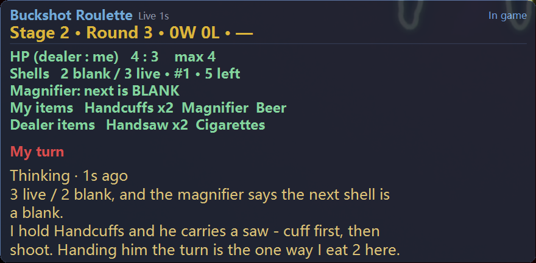

# 🎰 Let an AI play Buckshot Roulette by itself

> A kit that lets an AI read the board, make decisions, and press keys.
> **This is not a cheat** — it doesn't change game logic, numbers, or probabilities; it just presses the keys you would have pressed anyway.

**中文**: [README.md](README.md)



---

## The lazy path: let the AI install it

1. Unzip to a **short path** (like `D:\buckshot-ai\`)
2. Open a fresh AI session with **`danger-full-access`**
3. Say:

```
read docs/AI-INSTALL.md and install it per that doc, then start playing per docs/PLAYBOOK.md
```

The AI finds the game → unpacks → applies patches → rewrites paths → repacks → launches → verifies.
**If it fails it diagnoses itself** (the playbook has a fix for every error we hit).

> If the AI says "permission denied", that's the **session permission**, not the pack — switch to `danger-full-access` and retry.

---

## Which doc to read

| Doc | For | When |
|---|---|---|
| **README.md** | 👤 you | start here (you're reading it) |
| **docs/INSTALL.md** | 👤 you | detailed install steps and troubleshooting ([中文](docs/INSTALL.md)) |
| **docs/AI-INSTALL.md** | 🤖 AI | if you'd rather not install it yourself, hand the AI: `read docs/AI-INSTALL.md and install it` |
| **docs/AI-OPENING.md** | 🤖 AI | once installed, paste this so it starts playing ([中文](docs/AI-OPENING.md)) |
| **docs/PLAYBOOK.md** | 🤖 AI | the AI reads this itself (rules, items, decision flow, 1054 lines) |
| **docs/DESIGN.md** | 🤖 AI / you | only when something odd happens (1066 lines of every pitfall so far) |

---

# 1. What this is

A kit that lets **an AI play Buckshot Roulette by itself**.

It has two parts:

1. **A mod** (4 modified game scripts) — it exposes the game's internal state and accepts key presses from outside
2. **A set of tools** (11 files: 10 Python scripts + 1 HUD script) — they let the AI see the board, make decisions, and drive the game

**This is not a cheat.** It doesn't change game numbers, doesn't grant invincibility, doesn't rig probabilities — it just **presses the keys you would have pressed anyway**.

---

# 2. What's in the pack

(See the table at the top. The AI's full playbook is `docs/PLAYBOOK.md` — 1054 lines: launch → decision loop → rules → both modes → HUD.)

## 🩹 Patches (1 directory, 4 files)

| File | Notes |
|---|---|
| `patches/HealthCounter.gd.patch` | the main patch (+1234 lines) |
| `patches/GlobalVariables.gd.patch` | +196 lines |
| `patches/ItemManager.gd.patch` | +19 / -16 lines |
| `patches/IntroManager.gd.patch` | +4 / -4 lines |

**Why patches instead of whole files?**

Because those 4 `.gd` files are **source code written by the game's developers**.
Shipping the whole file = redistributing someone else's code, which is infringement.
Shipping the "diff" = shipping **only the part I wrote**; you apply it to your own game files to get the result — legally clean.

## 🔧 Tools (11 files: 10 Python scripts + 1 HUD script)

| File | What it does |
|---|---|
| `tools/setup.py` | **one-shot install**: unpack → apply patches → rewrite paths → copy the portrait → repack |
| `tools/br-permcheck.py` | **permission self-check** (run this first: can the session write `%APPDATA%`?) |
| `tools/pckpack.py` | the packer (called by setup.py) |
| `tools/pck.py` | PCK reader (setup.py depends on it) |
| `tools/br-launch.py` | standard launch: start the game → snap the window → start the loop + HUD |
| `tools/br-run2.py` | the main loop (decision points live here) |
| `tools/br-hud.ps1` | **the status HUD** (floating, click-through, zh/en, auto-scales to screen width) |
| `tools/br-turn.py` | single-step tool (`wait-decision` etc.) |
| `tools/br-set.py` | writes `think.txt` + `decision.txt` in one call (saves tokens, survives quoting) |
| `tools/br-next.py` | writes the decision and waits for the next hand in one model call |
| `tools/br-dialogue.py` | reads the in-game dialog box (Burner Phone results) |

## 🎨 Assets (1)

| File | Notes |
|---|---|
| `art/char-200.png` | the portrait in the HUD's bottom-right corner |

---

# 3. How to install (three steps, idiot-proof)

## Prerequisites

- ✅ A **legit** copy of Buckshot Roulette (bought on Steam)
- ✅ **Windows**
- ✅ **Python 3** installed

## Step 1: Unzip

Unzip it somewhere with a **not-too-long path**, e.g. `D:\buckshot-ai\`.

> ⚠️ **Don't unzip into a deep, long path** — some file names inside are very long,
> and blowing past Windows' 260-character limit makes it error out.
> A short path like `D:\buckshot-ai\` is the safest.

## Step 2: One command does it

Open PowerShell in that folder and run:

```powershell
python tools\setup.py --exe "C:\Program Files (x86)\Steam\steamapps\common\Buckshot Roulette\Buckshot Roulette_windows\Buckshot Roulette.exe"
```

**Put your own game exe path in there.** It does four things automatically:

1. Unpacks your game files into `out\pckall`
2. Applies the patches to the original `.gd` files
3. **Rewrites the hard-coded paths to this machine's real paths** (no manual editing)
4. Repacks into `out\br\mod.pck` (about 700 MB)

**Time**: about **3–5 minutes** the first run (unpacking is slow), ~20 seconds after that.

When you see `完成！` ("done"), you're set.

> If it says it can't find the exe, check the path for typos and for quotes.
> If it reports `FileNotFoundError` and the path is long, move to a short path and start over.

## Step 3: Let the AI play

Open an AI session (Claude Code, DSH, or similar), **set the permission to `danger-full-access`**,
point it at this folder, and send:

```
read docs/PLAYBOOK.md, then launch per section 1 and start playing per section 2.
```

**Or just use the block inside `docs/AI-OPENING.md`** (more detailed — that one is recommended).

---

# 4. Three fatal traps

## Trap 1: the permission must be `danger-full-access`

The game needs to write `%APPDATA%\Godot\...\logs` (**outside the workspace**).

Under `workspace-write` the game won't start, and **the error looks exactly like a broken mod**:

```
Failed to open user://logs/godot.log
USER SCRIPT ERROR: Parse Error: ...
```

**On an error like this, check the permission first — don't go digging in the mod.**

## Trap 2: Chinese text in the console is mojibake

PowerShell renders Chinese as stuff like `����̡�1`.

**The AI must read items by reading the file**, never by parsing console output.
Guessing item names from mojibake goes wrong (the original session guessed wrong three times).

## Trap 3: editing `.gd` needs whole-line matching

`str.replace(bare substring)` also matches inside indented lines — it inserts the newline,
eats the next line's indentation, and the whole mod fails to compile.

**Use `ln == '...'` or `ln.strip() == '...'`.**

---

# 5. FAQ

## The game is running, but the AI does nothing?

```powershell
Get-Content out\br\run2.log -Tail 20
```

- Log is empty → the loop never started
- Log stops somewhere → see where it's stuck
- HUD says `Waiting for match…` → the game is sitting in its menu; have the AI send `menu_start`

**One more possibility**: the path rewrite from step 2 didn't take effect.
Check whether `out\br\state.json` is still being updated:
```powershell
Get-Item out\br\state.json | Select-Object LastWriteTime
```
If that time never moves, the mod can't write files → rerun step 2.

## The HUD doesn't show up?

```powershell
powershell -NoProfile -ExecutionPolicy Bypass -File tools\br-hud.ps1
```

## Want to change the name?

```
out\br\player_name.txt
```

- **6 characters max** (the signature machine has only 6 slots)
- **letters a-z only**
- **Restart the game** for it to take effect

## Want it to play endless mode?

Tell the AI:
```
Play this run in endless mode (take the pill), pick ✔
```

## Want a different HUD portrait?

Replace `out\br\char-200.png` (200px wide, transparent background recommended).

---

# 6. Copyright ✅

This pack **contains no game code**:

- ❌ no game itself
- ❌ no complete `.gd` files
- ✅ only **patches** (the diffs I made)

You patch your own legit game files to get the result — that's the standard approach.

**But note**: the patched `out\br\mod.pck` and `out\br\patch\scripts\*.gd`
are **generated on your own machine** — don't pass those on to anyone else (those are the things that do contain game code).

---

## Portrait (that character in the HUD's bottom-right)

`setup.py` **automatically** copies `art/char-200.png` to `out/br/char-200.png`.

**If you never ran setup.py, or the HUD's bottom-right is empty**, copy it by hand once:

```powershell
mkdir out\br -Force
copy art\char-200.png out\br\char-200.png
```

Then restart the HUD:

```powershell
powershell -NoProfile -ExecutionPolicy Bypass -File tools\br-hud.ps1 -Action stop
powershell -NoProfile -ExecutionPolicy Bypass -File tools\br-hud.ps1
```

**To use your own image**: 200px wide, transparent PNG recommended.

---

## UI language (zh / en)

The HUD is bilingual. Edit `out\br\lang.txt`:

```
zh     Chinese (default)
en     English
```

**Restart the HUD to apply** (no reinstall, no repack).

Want English item names on screen? The HUD shows English, but **the decision file accepts both Chinese and English
item names**, so the AI's work is unaffected.

---

## The HUD size is adjustable

The HUD **scales itself to the screen width**, so you normally don't touch it.

If it's too big or too small, write a number in `out\br\hud_scale.txt` (`0.8` smaller, `1.3` larger); the range is 0.65–1.6. Delete that file to go back to automatic.

---

## The AI learns by itself (and you can teach it)

When it loses, the AI writes a lesson into `out\br\lessons.md`. **Next time it starts up, it reads that file first.**

**That's your training entry point**: you can edit that file directly and hand it experience like "when low on HP, steal the Cigarettes first".

**Two rules** (they're written in the file as well):
- **Learn items only**, not luck ("last time I shot myself and died, so this time shoot the dealer" is wrong — that's a random outcome)
- **No more than 12 entries, no more than 3 lines each** — too many slows every decision down

**Different people training their AI will end up with different AIs.**

---

## 🧠 The pack already ships a set of "AI experience"

`out\br\lessons.md` is not empty — **6 entries in it were distilled from dozens of our games**.

They cover the mistakes the AI makes most: not healing when low, not using information it has, inventing items it isn't holding, not knowing how to play Handcuffs.

**Do nothing and it starts out already carrying that experience**, which beats training it from zero by a mile.

### Want it to start from zero?

Just have it empty that file:

```
Delete every lesson in out/br/lessons.md, keep only the format notes at the top.
After that I'll play it myself and write lessons in when I lose.
```

**Cost**: it will repeat those traps (not using items, gambling at low HP, inventing items).
**Benefit**: that's an AI **you trained yourself**, and its style will look more like yours.

### Or mix and match

Keep the ones you agree with, delete the ones you want it to work out on its own. **That file is your training entry point.**

---

## 📁 Where to unzip it (don't scatter it)

The archive contains a single `恶魔轮盘AI` folder, **so unzipping gives you exactly that one folder** — no .md files strewn all over the place.

**Suggested**: the Desktop, or a short path under `D:\`.

**Then go into that folder** and send the AI the block from `docs/AI-OPENING.md`.

**Why the location matters**: the game contains a 270-character resource path, and a deeply nested location can hit Windows' 260-character limit
(the install script already works around it, but a short path is always safer).

**What it looks like once installed**:

```
恶魔轮盘AI\
├── README.md                 ← you're reading it
├── docs\                     ← INSTALL / PLAYBOOK / DESIGN / screenshots
├── tools\  patches\  art\    ← scripts / patches / portrait
├── lessons.md  style.txt  lang.txt   ← the AI's training assets (setup.py copies them to out\br\)
└── out\br\mod.pck            ← 704MB, produced by the install; this is the one that does the work
```

**It ends up taking only 704MB** (the install needs 2GB temporarily, then cleans it up automatically).

---

## ✍️ Whose name gets signed?

The game opens by having you sign a contract, and **the AI types the name in automatically**.

**It signs `player` by default.**

**To change it**: write your own name into `out\br\player_name.txt` (**6 letters max** —
the signature machine only has 6 slots), then restart the loop.

```
out\br\player_name.txt contents: your name
```

**Note**: the signature machine only accepts lowercase letters — digits and symbols won't type in.
