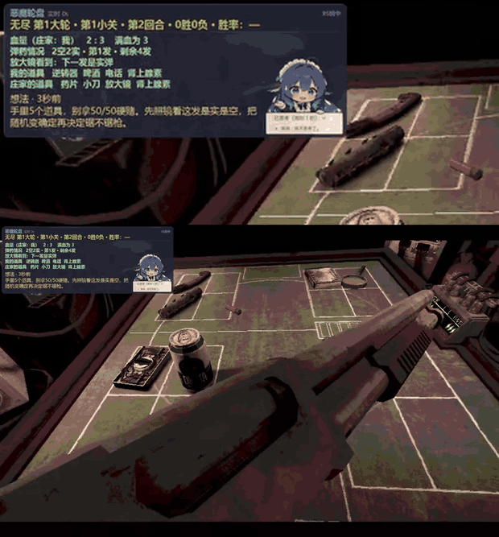

# 🎰 让 AI 自己打通《恶魔轮盘》

> 一套让 AI 自己读局面、做决策、按键的套件。
> **它不是外挂** —— 不改游戏逻辑、不改数值、不改概率，只是替你按你本来会按的键。

**English**: [README.en.md](README.en.md) · [INSTALL](docs/INSTALL.en.md) · [PLAYBOOK](docs/PLAYBOOK.en.md)



---

## 最省事的路：让 AI 自己装

1. 解压到**短路径**（`D:\buckshot-ai\` 这种）
2. 开一个新的 AI 会话，**权限设成 `danger-full-access`**
3. 说一句：

```
读 docs/AI-INSTALL.md，照它装好，然后按 docs/PLAYBOOK.md 开始打。
```

AI 会自己找游戏 → 解包 → 打补丁 → 换路径 → 重打包 → 启动 → 验证。
**失败了它会自己排查**（手册里每个报错都有处理办法）。

> AI 说「权限不够」时，那是**会话权限**没设对，不是包的问题 —— 改成 `danger-full-access` 让它重试。

---

## 文档速查

| 文档 | 谁看 | 什么时候看 |
|---|---|---|
| **README.md** | 👤 你 | ← 一开始就看这份（正在看的） |
| **docs/INSTALL.md** | 👤 你 | 装的时候详细步骤、排错（[English](docs/INSTALL.en.md)） |
| **docs/AI-INSTALL.md** | 🤖 AI | 你懒得自己装，把这句丢给 AI：`读 docs/AI-INSTALL.md，照它装好` |
| **docs/AI-OPENING.md** | 🤖 AI | 装好之后，把这段复制给 AI 让它开始打（[English](docs/AI-OPENING.en.md)） |
| **docs/PLAYBOOK.md** | 🤖 AI | AI 自己读，不用你管（游戏规则、道具、决策流程，1048 行） |
| **docs/DESIGN.md** | 🤖 AI / 你 | 出怪问题才查（1066 行，所有踩过的坑） |

---

# 一、这是什么

一套让 **AI 自己打通《恶魔轮盘》** 的套件。

由两部分组成：

1. **一个 mod**（4 个改过的游戏脚本）—— 把游戏内部状态读出来，接受外部指令按键
2. **一套工具**（11 个文件：10 个 Python 脚本 + 1 个面板脚本）—— 帮 AI 看局面、做决策、控制游戏

**它不是外挂。** 不改游戏数值、不开无敌、不改概率 —— 只是**替你按你本来会按的键**。

---

# 二、包里有什么

（文档清单见开头那张表。AI 的完整手册是 `docs/PLAYBOOK.md`：1048 行，启动 → 决策循环 → 游戏规则 → 两种模式 → 面板。）

## 🩹 补丁（1 个目录，4 个文件）

| 文件 | 说明 |
|---|---|
| `patches/HealthCounter.gd.patch` | 主补丁（+1234 行） |
| `patches/GlobalVariables.gd.patch` | +196 行 |
| `patches/ItemManager.gd.patch` | +19 / -16 行 |
| `patches/IntroManager.gd.patch` | +4 / -4 行 |

**为什么要用补丁而不是完整文件？**

因为这 4 个 `.gd` 是**游戏开发者写的源代码**。
直接发完整文件 = 转发别人的代码，是侵权。
发「差异」= 只发**我写的部分**，你用自己的游戏文件打上补丁得到结果 —— 法律上干净。

## 🔧 工具（11 个文件：10 个 Python 脚本 + 1 个面板脚本）

| 文件 | 作用 |
|---|---|
| `tools/setup.py` | **一键安装**：解包 → 打补丁 → 自动改路径 → 复制立绘 → 重新打包 |
| `tools/br-permcheck.py` | **权限自检**（装之前先跑：会话能不能写 `%APPDATA%`） |
| `tools/pckpack.py` | 打包器（setup.py 会调用） |
| `tools/pck.py` | 读 PCK 的工具（setup.py 依赖） |
| `tools/br-launch.py` | 标准启动：起游戏 → 窗口归位 → 起循环 + 起面板 |
| `tools/br-run2.py` | 主循环（决策点在这里） |
| `tools/br-hud.ps1` | **状态面板**（浮窗，鼠标可穿透，中英双语，按屏幕自动缩放） |
| `tools/br-turn.py` | 单步工具（`wait-decision` 等） |
| `tools/br-set.py` | 一条命令写 `think.txt` + `decision.txt`（省 token、防引号撑破） |
| `tools/br-next.py` | 写决策 + 等下一手，一手只花一次模型请求 |
| `tools/br-dialogue.py` | 读游戏对话框（电话结果） |

## 🎨 资源（1 个）

| 文件 | 说明 |
|---|---|
| `art/char-200.png` | 面板右下角的立绘 |

---

# 三、怎么装（三步，傻瓜版）

## 前提

- ✅ 有**正版**《Buckshot Roulette》（Steam 买）
- ✅ 用 **Windows**
- ✅ 装了 **Python 3**

## 第 1 步：解压

解压到一个**路径不太长**的地方，比如 `D:\buckshot-ai\`。

> ⚠️ **别解压到很深很长的路径里** —— 解包时有些文件名特别长，
> 超过 Windows 的 260 字符限制会报错。
> `D:\buckshot-ai\` 这种短路径最安全。

## 第 2 步：一条命令搞定

在这个文件夹里开 PowerShell，跑：

```powershell
python tools\setup.py --exe "C:\Program Files (x86)\Steam\steamapps\common\Buckshot Roulette\Buckshot Roulette_windows\Buckshot Roulette.exe"
```

**把你的游戏 exe 路径填进去。** 它会自动做四件事：

1. 解包你的游戏文件到 `out\pckall`
2. 应用补丁到原始的 `.gd` 上
3. **自动把文件里的路径换成你这台机器的真实路径**（不用手动改）
4. 重新打包成 `out\br\mod.pck`（约 700 MB）

**耗时**：第一次约 **3~5 分钟**（解包慢），之后约 20 秒。

看到 `完成！` 就成了。

> 如果报错说找不到 exe，检查路径有没有写错、有没有引号。
> 如果报错 `FileNotFoundError` 且路径很长，换个短路径重来。

## 第 3 步：让 AI 玩

开一个 AI 会话（Claude Code / DSH 之类），**权限设成 `danger-full-access`**，
把它指到这个文件夹，然后发：

```
读 docs/PLAYBOOK.md，然后按第 1 节启动、第 2 节开始打。
```

**或者直接用 `docs/AI-OPENING.md` 里那段**（更详细，建议用那个）。

---

# 四、三个致命坑

## 坑 1：权限必须是 `danger-full-access`

游戏要写 `%APPDATA%\Godot\...\logs`（**工作区之外**）。

权限是 `workspace-write` 时游戏起不来，而且**报错长得像 mod 坏了**：

```
Failed to open user://logs/godot.log
USER SCRIPT ERROR: Parse Error: ...
```

**看到这种错先查权限，别去查 mod。**

## 坑 2：控制台中文是乱码

PowerShell 把中文输出成 `����̡�1` 这种。

**AI 读道具必须用「读文件」的方式**，不能解析控制台输出。
靠乱码猜道具名会出错（原会话里猜错过三次）。

## 坑 3：改 `.gd` 要整行匹配

`str.replace(裸子串)` 会匹配到带缩进的行内部，把换行插进去、吃掉下一行的缩进 →
整个 mod 编译失败。

**用 `ln == '...'` 或 `ln.strip() == '...'`。**

---

# 五、常见问题

## 游戏起来了，但 AI 没反应？

```powershell
Get-Content out\br\run2.log -Tail 20
```

- 日志空 → 循环没起来
- 日志停在某处 → 看卡在哪
- 面板显示「等待对局」→ 游戏在菜单，让 AI 发 `menu_start`

**还有一种可能**：第 2 步的路径替换没生效。
检查 `out\br\state.json` 有没有在更新：
```powershell
Get-Item out\br\state.json | Select-Object LastWriteTime
```
如果时间不动，说明 mod 写不出文件 → 重跑第 2 步。

## 面板不显示？

```powershell
powershell -NoProfile -ExecutionPolicy Bypass -File tools\br-hud.ps1
```

## 想改名字？

```
out\br\player_name.txt
```

- **最多 6 个字符**（签名机只有 6 个格子）
- **只能字母 a-z**
- 改完**重启游戏**生效

## 想让它打无尽模式？

跟 AI 说：
```
这一把打无尽模式（嗑药），选 ✔
```

## 想换面板的立绘？

替换 `out\br\char-200.png`（建议 200px 宽、透明背景）。

---

# 六、版权 ✅

这个包**不含游戏代码**：

- ❌ 没有游戏本体
- ❌ 没有完整的 `.gd` 文件
- ✅ 只有**补丁**（我改动的差异）

你用自己的正版游戏文件打补丁得到结果 —— 这是标准做法。

**但注意**：打完补丁的 `out\br\mod.pck` 和 `out\br\patch\scripts\*.gd`
**是你自己机器上生成的**，别把那些再发给别人（那才是含游戏代码的东西）。

---

## 立绘（面板右下角那个角色）

`setup.py` 会**自动**把 `art/char-200.png` 复制到 `out/br/char-200.png`。

**如果你没跑 setup.py，或者面板右下角是空的**，手动复制一次：

```powershell
mkdir out\br -Force
copy art\char-200.png out\br\char-200.png
```

然后重启面板：

```powershell
powershell -NoProfile -ExecutionPolicy Bypass -File tools\br-hud.ps1 -Action stop
powershell -NoProfile -ExecutionPolicy Bypass -File tools\br-hud.ps1
```

**想换自己的图**：尺寸建议 200px 宽、透明背景 PNG。

---

## 界面语言（中/英）

面板支持中英双语。改 `out\br\lang.txt`：

```
zh     中文（默认）
en     English
```

**改完重启面板生效**（不用重装、不用重打包）。

想在游戏里看到英文道具名？面板会显示英文，但**决策文件里中英文都接受**，不影响 AI 工作。

---

## 面板大小可以调

面板会**自动按屏幕宽度缩放**，一般不用管。

嫌大嫌小就在 `out\br\hud_scale.txt` 里写个数字（`0.8` 变小，`1.3` 变大），范围 0.65~1.6。删掉这个文件就回到自动。

---

## AI 会自己学习（你也可以教它）

打输了之后，AI 会往 `out\br\lessons.md` 写一条教训。**下次开局它会先读这个文件。**

**这是你的训练入口**：你可以直接改那个文件，告诉它「残血优先偷香烟」这类经验。

**两个规矩**（文件里也写着）：
- **只学道具**，不学运气（"上次打自己死了所以这次打庄家"是错的 —— 那是随机结果）
- **不超过 12 条、每条不超过 3 行** —— 太多了会拖慢决策

**不同的人训练出来的 AI 会不一样。**

---

## 🧠 包里已经带了一份「AI 的经验」

`out\br\lessons.md` 里不是空的 —— **有 6 条是我们打了几十局蒸馏出来的**。

覆盖了 AI 最容易犯的错：低血不回血、有情报不用、编造手里没有的道具、手铐不会用。

**你不做什么，它一上手就带着这些经验**，比从零教它快得多。

### 想让它从零开始？

让它清空那个文件就行：

```
把 out/br/lessons.md 里的教训全部删掉，只保留顶部的格式说明。
之后你自己打，打输了往里面写教训。
```

**代价**：它会重演那些坑（不用道具、低血硬赌、编造道具）。
**好处**：那是**你自己训练出来的** AI，风格会更像你。

### 也可以混着来

留几条你觉得对的，删掉你想让它自己体会的。**这个文件就是你的训练入口。**

---

## 📁 解压位置（别乱放）

压缩包里自带一个 `恶魔轮盘AI` 文件夹，**解压出来就只有这一个文件夹**，不会散一地的 md。

**建议放在**：桌面 或 `D:\` 根目录下的短路径。

**然后进那个文件夹**，把 `docs/AI-OPENING.md` 里的那段发给 AI。

**为什么强调位置**：游戏里有 270 字符的资源路径，太深的位置可能撞 Windows 的 260 限制
（安装脚本已经做了兼容，但短路径永远更稳）。

**装完的样子**：

```
恶魔轮盘AI\
├── README.md                 ← 你正在看的
├── docs\                     ← 文档：INSTALL / PLAYBOOK / DESIGN / 截图
├── tools\  patches\  art\    ← 脚本 / 补丁 / 立绘
├── lessons.md  style.txt  lang.txt   ← AI 的训练资产（setup.py 会复制到 out\br\）
└── out\br\mod.pck            ← 704MB，装出来的，这个才是干活的
```

**最终只占 704MB**（安装过程临时需要 2GB，装完自动清理）。

---

## ✍️ 签名用谁的名字？

游戏开场要你在契约上签名，**AI 会自动打上名字**。

**默认打 `player`。**

**想换**：在 `out\br\player_name.txt` 里写自己的名字（**最多 6 个字母**，
游戏签名机只有 6 格），然后重启循环。

```
out\br\player_name.txt 的内容：你的名字
```

**注意**：签名机只认小写字母，数字和符号打不进去。
